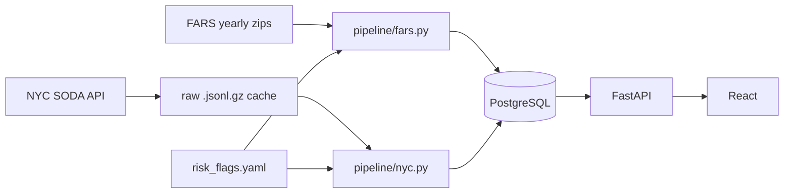

# DriveAnalytics

**Where do crashes happen, when, and why: built on real US crash records.**

DriveAnalytics loads two public datasets into PostgreSQL and makes them searchable:

- **NHTSA FARS**: every fatal crash on a US public road, with location, time, weather, lighting, road type, and whether speeding or a drinking driver was involved.
- **NYC Open Data Motor Vehicle Collisions**: every police-reported crash in New York City since July 2012, with coordinates, injuries and up to five contributing factors.

The goal is a tool anyone can use to look up crash history near an address or along a route, see which intersections are most dangerous by severity rather than raw counts, and understand what conditions show up in crashes near them.

## Status

| Phase | What | State |
|---|---|---|
| 1. Data | Reproducible download + load of FARS and NYC into PostgreSQL, risk-factor flags, tests | **Done** |
| 2. API | Crashes near a point or route (PostGIS), intersections ranked by severity, time-of-day/weather/factor breakdowns, year-over-year trends | Next |
| 3. UI | Address search, crash map, charts, street-level imagery of a location (Mapillary) | Planned |
| 4. Deploy | Hosted demo, docs | Planned |

### What's loaded today (local run, Nov 2026)

| Dataset | Rows | Notes |
|---|---:|---|
| FARS 2020–2024 | 189,208 fatal crashes, 205,237 deaths | 188,403 (99.6%) have usable coordinates |
| NYC crashes, Jul 2012 – Nov 2026 | 2,305,623 crashes, 779,449 people injured, 3,746 killed | 2,056,192 (89.2%) have usable coordinates |

These are counts from this project's own load, not official statistics. NHTSA and NYPD publish their own totals.

## How it works



- **Loaders** (`backend/pipeline/`):
  - They download and cache the raw files, clean them, and load PostgreSQL in batches.
  - They're safe to re-run: a FARS year is replaced in one transaction, and NYC rows are upserted.
  - Source quirks, such as FARS's `77.7777` "unknown latitude" codes and NYC's 0/0 coordinates, are handled and documented in [`docs/DATA_SOURCES.md`](docs/DATA_SOURCES.md).
- **Risk flags** (`backend/config/risk_flags.yaml`):
  - Readable YAML rules such as "speeding involved", "dark, no street lighting" or "pedestrian injured", attached to each crash at load time.
  - The rule engine accepts only whitelisted fields and operators and never executes code. See [`docs/RISK_FLAGS.md`](docs/RISK_FLAGS.md).
- **API**: FastAPI. Phase 1 endpoints are listed in [`docs/ARCHITECTURE.md`](docs/ARCHITECTURE.md).

## Run it locally

Requires Python 3.12+, Node 22+ and PostgreSQL. SQLite works for quick tries, but the NYC load is large.

```powershell
cd backend
py -m venv .venv
.\.venv\Scripts\Activate.ps1
pip install -r requirements.txt

# Point at PostgreSQL (keep the password in pgpass.conf, not here)
$env:DATABASE_URL = "postgresql+psycopg2://postgres@127.0.0.1:5432/driveanalytics"

python -m pipeline fars --years 2020-2024   # ~170 MB download, a few minutes
python -m pipeline nyc                       # ~2.3M rows; took ~7 min to download + ~23 min to load here
python -m pipeline nyc --since 2026-11-01    # later: only rows added or amended since a date

uvicorn app.main:app --reload
```

```powershell
cd frontend
npm install
npm run dev     # http://localhost:5173
```

The API accepts browser requests only from `http://localhost:5173` by default. If Vite picks another port, set `CORS_ORIGINS=http://localhost:<port>` before starting the backend. If the API isn't on port 8000, set `VITE_API_BASE_URL` before starting the frontend.

With Docker:

1. Copy `.env.docker.example` to `.env` and set a password.
2. Run `docker compose up --build -d`.
3. Run `docker compose run --rm backend python -m pipeline fars`.

## Tests

```powershell
cd backend
pytest
```

The tests build small FARS zips and NYC files in their real formats, including a cp1252-encoded FARS file, so CI never downloads anything. They cover:

- parsing and "unknown" codes
- encoding fallback
- re-run safety
- upsert of amended NYC records
- keyset paging
- rule validation
- API filters

## Limits

- FARS covers only crashes in which someone died, so it shows where people die, not where most crashes happen.
- NYC data is preliminary, and contributing factors are an officer's judgment at the scene.
- Neither dataset includes traffic volume, so a busy road will show more crashes than a quiet one without being riskier per trip. Rankings will say this clearly.
- No crash footage is used or linked. Location imagery (Phase 3) shows what a place looks like, not the crash.

## History

This repository began as **SafeDrive**, a demo built on one million rows of synthetic self-driving-car telemetry. It was rebuilt on real data because synthetic data couldn't answer any real question. The FastAPI/PostgreSQL backend, the YAML rule engine (now risk flags), the tests, CI and Docker setup carried over. The synthetic data, its generators, the Spark job and the benchmark that went with them were removed.
