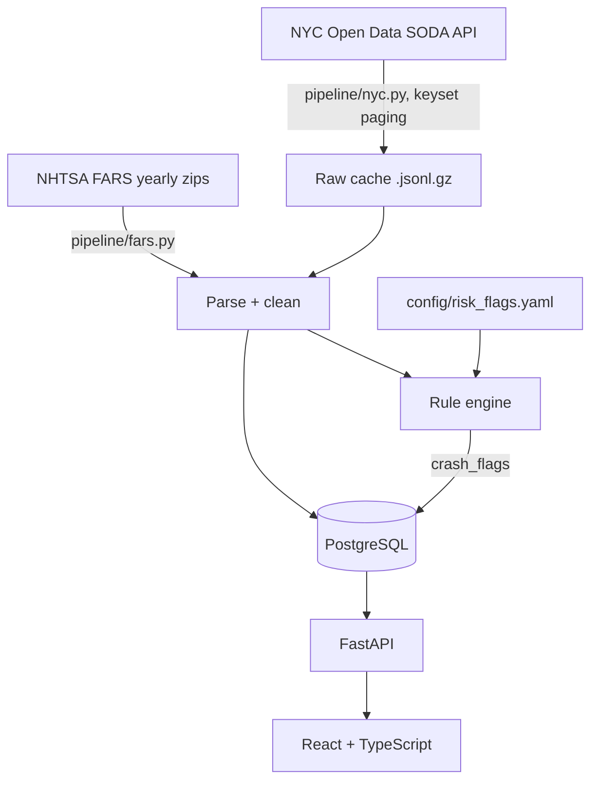

# Architecture

## Tables

| Table | One row per | Notes |
|---|---|---|
| `fars_crashes` | fatal US crash | Key `"{year}-{ST_CASE}"`; vehicle-level speeding/drinking/speed limit rolled up per crash |
| `nyc_crashes` | NYC crash | Key `collision_id` from the source |
| `nyc_crash_factors` | contributing factor per vehicle | Separate table so "why" questions are a `GROUP BY` |
| `crash_flags` | (source, crash, flag) | Risk flags from the YAML rules |
| `ingest_runs` | load run | What was loaded, from which URL, when, and how many rows were skipped |

Both crash tables have a `(latitude, longitude)` B-tree index, which is enough for bounding-box filters. Phase 2 adds PostGIS for distance queries such as "within 500 m of this address" and measures whether its spatial index actually helps before claiming it does.

## Pipeline design choices

- **Plain Python instead of PySpark.** The earlier synthetic version used PySpark. These loads are small for Spark: about 190k FARS crashes for five years, and 2.3M NYC rows read in a stream of 2,000-row batches. Spark would add a JVM and Hadoop setup on Windows without making the load meaningfully faster or simpler, so it was removed. If a later feature needs heavy aggregation over all years of FARS person and vehicle files, Spark can return there.
- **Download, then load.** Raw files are cached under `backend/data/raw/` (git-ignored). Loads can be repeated offline and are idempotent: a FARS year is replaced in one transaction, and NYC rows are upserted.
- **Database-agnostic SQL** through SQLAlchemy. PostgreSQL is the real target. Tests run on SQLite with small fixture files built in the test, so CI never downloads anything.

## API (Phase 1)

| Endpoint | Returns |
|---|---|
| `GET /health` | `{"status": "ok"}` |
| `GET /api/datasets` | What is loaded: FARS crashes and deaths per year, NYC row count, date range and share with coordinates, last load time |
| `GET /api/risk-flags` | Every flag definition with the number of crashes it matched |
| `GET /api/fars/crashes` | Filters: `year`, `state_code`, `flag`, `bbox=min_lon,min_lat,max_lon,max_lat`, `limit` |
| `GET /api/nyc/crashes` | Filters: `borough`, `start`, `end`, `flag`, `bbox`, `limit`; includes contributing factors |
