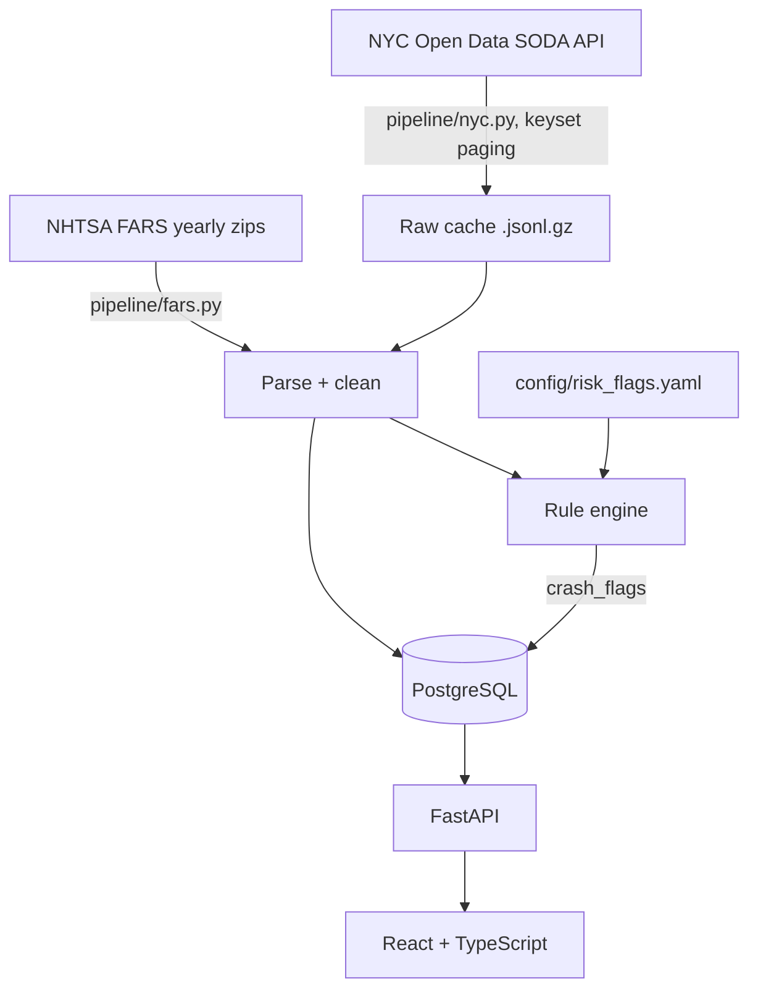

# Architecture

## Tables

| Table | One row per | Notes |
|---|---|---|
| `fars_crashes` | fatal US crash | Key `"{year}-{ST_CASE}"`; vehicle-level speeding/drinking/speed limit rolled up per crash |
| `nyc_crashes` | NYC crash | Key `collision_id` from the source |
| `nyc_crash_factors` | contributing factor per vehicle | Separate table so "why" questions are a `GROUP BY` |
| `crash_flags` | (source, crash, flag) | Risk flags from the YAML rules |
| `ingest_runs` | load run | What was loaded, from which URL, when, and how many rows were skipped |

Both crash tables have a `(latitude, longitude)` B-tree index, which is enough for bounding-box filters. Phase 2 adds PostGIS for distance queries such as "within 500 m of this address" and measures whether its spatial index actually helps before claiming it does.

## Pipeline design choices

- **Plain Python instead of PySpark.** The earlier synthetic version used PySpark. These loads are small for Spark: about 190k FARS crashes for five years, and 2.3M NYC rows read in a stream of 2,000-row batches. Spark would add a JVM and Hadoop setup on Windows without making the load meaningfully faster or simpler, so it was removed. If a later feature needs heavy aggregation over all years of FARS person and vehicle files, Spark can return there.
- **Download, then load.** Raw files are cached under `backend/data/raw/` (git-ignored). Loads can be repeated offline and are idempotent: a FARS year is replaced in one transaction, and NYC rows are upserted.
- **Database-agnostic SQL** through SQLAlchemy. PostgreSQL is the real target. Tests run on SQLite with small fixture files built in the test, so CI never downloads anything.

## API (Phase 1)

| Endpoint | Returns |
|---|---|
| `GET /health` | `{"status": "ok"}` |
| `GET /api/datasets` | What is loaded: FARS crashes and deaths per year, NYC row count, date range and share with coordinates, last load time |
| `GET /api/risk-flags` | Every flag definition with the number of crashes it matched |
| `GET /api/fars/crashes` | Filters: `year`, `state_code`, `flag`, `bbox=min_lon,min_lat,max_lon,max_lat`, `limit` |
| `GET /api/nyc/crashes` | Filters: `borough`, `start`, `end`, `flag`, `bbox`, `limit`; includes contributing factors |

## Map API

These endpoints all use FARS. `state_code` and `county_code` are FIPS codes, and every endpoint also accepts `year_from` and `year_to`.

| Endpoint | Returns |
|---|---|
| `GET /api/map/states` | Fatal crashes and deaths per state |
| `GET /api/map/counties?state_code=48` | The same per county, with a 5-digit `fips` that matches the boundary file |
| `GET /api/map/cities?state_code=48[&county_code=201]` | Cities with the most deaths, with an average location for the map bubble |
| `GET /api/map/summary?state_code=48[&county_code=…][&city=…]` | Top roads (grouped by route key), flag counts and crashes by hour for one area |
| `GET /api/map/crashes?state_code=48&county_code=201` | Crash points with coordinates and flags, for the dots on the map |

Road ranking groups on `fars_crashes.road_route`, a key the loader derives from FARS's free-text road name (`TWAY_ID`). The rules are in `pipeline/fars.py:route_key` and covered by tests.

## Frontend

- `frontend/src/api.ts`: API client and types.
- `frontend/src/geo.ts`: loads state and county boundaries from the `us-atlas` package. Counties load lazily (about 800 KB), only when a state is opened.
- `frontend/src/components/CrashMap.tsx`: the Leaflet map, with shaded states and counties, city bubbles and crash dots.
- `frontend/src/components/SidePanel.tsx`: breadcrumbs, totals, ranked lists, roads, factors and time of day.

## Recent and live data

| Endpoint | Returns |
|---|---|
| `GET /api/recent/coverage` | Each non-FARS source: kind (`record` or `live`), label, FIPS states, bounding box |
| `GET /api/recent/summary?start=&end=&bbox=` | Per-source counts, deaths/injuries where known, and first/last time in the window |
| `GET /api/recent/points?start=&end=&bbox=` | Newest located crashes and incidents, up to `limit` per table |
| `GET /api/recent/monthly` | Crashes per month per source |
| `GET /api/live/sources` | Each live feed's last poll, last error and newest incident |
| `GET /api/live/incidents?hours=` | Live incidents in the last N hours |

- **Live feeds** are adapters in `backend/pipeline/live/`. They follow the contract in `base.py` and are run by `poller.py`, which upserts into `live_incidents` and records each poll in `live_polls`.
- **Errors:** a failing feed is recorded and skipped, so it never stops the others.
- **Bounding boxes:** area filters use a bounding box, so a county's count can include a little of its neighbors. PostGIS (Phase 2) will allow exact boundaries.
